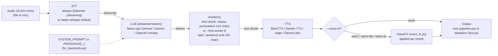
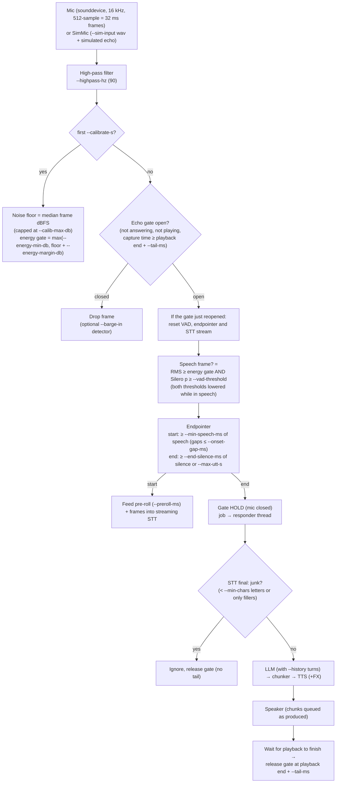

# Hebrew low-latency voice pipeline: documentation

This document describes the code in this folder and the measurements that were run with it. It is a research
prototype for spoken conversation in Hebrew with a low **time to first audio (TTFA)**. The default stack is fully local
and needs no API key:

* **STT:** ivrit.ai Hebrew streaming Zipformer, run with `sherpa-onnx` (int8, CPU)
* **LLM:** Gemma-4 E2B Q4 through `llama.cpp`. Gemini Flash-Lite over the API is an alternative.
* **TTS:** BlueTTS 2.5 (ONNX, CPU), with optional "witch" voices, voice FX and a persona

The project has two entry points:

* `pipeline.py` is an offline harness. It reads audio files, runs them through the pipeline and reports per-stage latency.
* `live.py` is a live conversation through a microphone and speakers. It adds an echo gate, Silero VAD noise filtering and
  turn taking. Its `--sim-input` mode runs the same logic on a wav file instead of a microphone.

All numbers in this document come from the result files in this folder (`results_*.json`, `eval_results.txt`,
`out_live/test_report.json`). They were measured on a box with 8 vCPU, 15 GB RAM and **no GPU**, using synthetic test audio.

---

## Contents
1. [Architecture](#1-architecture)
2. [Installation](#2-installation)
3. [Models and where they come from](#3-models-and-where-they-come-from)
4. [Quickstart](#4-quickstart)
5. [Live mode usage](#5-live-mode-usage)
6. [CLI reference](#6-cli-reference)
7. [Backends and environment variables](#7-backends-and-environment-variables)
8. [Personas](#8-personas)
9. [Voices and voice FX](#9-voices-and-voice-fx)
10. [Echo gating and noise filtering](#10-echo-gating-and-noise-filtering)
11. [Measured results](#11-measured-results)
12. [Testing](#12-testing)
13. [Troubleshooting](#13-troubleshooting)
14. [Known limitations](#14-known-limitations)
15. [File layout](#15-file-layout)

---

## 1. Architecture

### 1.1 Turn pipeline (shared by `pipeline.py` and `live.py`)



* **Chunking** (`hv_backends.chunker`): the TTS starts on the first speakable chunk and does not wait for the whole reply.
  The first chunk is cut at clause punctuation (`. ! ? ; : , ، newline …`) once at least 12 characters have arrived. With
  `--first-words N > 0` it is also cut as soon as N complete words have arrived. Later chunks are cut at sentence ends
  (`. ! ? newline …`) after at least 25 characters.
* **TTS is per chunk.** Each chunk is synthesised whole (BlueTTS) or collected whole (streaming cloud TTS). In live mode
  each chunk goes to the speaker as soon as it is ready.
* **TTFA** in `pipeline.py` = STT finalisation time + LLM time to first speakable chunk + TTS time for the first chunk
  (FX included). It is measured from the **end of user speech** and does **not** include end-of-speech detection.

### 1.2 Live mode: front end, gating and turn taking (`live.py`)



The design is **half-duplex**. The mic is closed from the moment a user turn ends until the bot's reply has finished
playing plus `--tail-ms`. Frames are judged by their **capture time**, so frames that were captured during playback and are
still waiting in the queue are dropped as well.

---

## 2. Installation

### 2.1 Requirements
* **Python 3.12.** `setup.sh` creates `.venv` with `uv venv --python 3.12`. The tested venv runs Python 3.12.15.
* **`uv`** and the Hugging Face CLI **`hf`** (from `huggingface_hub`). `setup.sh` installs `huggingface_hub` into the venv.
* **`git`** and **`curl`**.
* **`ffmpeg` on PATH.** `hv_backends.load_wav16k` (all input files) and the edge-tts decoder run `ffmpeg` as a subprocess.
  `setup.sh` does **not** install it.
* Disk: about 330 MB for the Zipformer repo, 269 MB for the BlueTTS ONNX models, 2.9 GB for Gemma-4 E2B Q4,
  plus 2.4 GB if you also download the optional Gemma-3 4B.

### 2.2 Linux (tested)
```bash
./setup.sh                        # venv + Python packages + BlueTTS + models + Silero VAD
sudo apt install ffmpeg           # if not already present
sudo apt install libportaudio2    # needed only by live.py (sounddevice)
. .venv/bin/activate
```
`setup.sh` runs these steps:
1. `uv pip install faster-whisper edge-tts soundfile numpy scipy pedalboard onnxruntime huggingface_hub openai httpx sherpa-onnx sounddevice`
2. `llama-cpp-python` from the CPU wheel index (`--only-binary`)
3. `git clone --depth 1 https://github.com/maxmelichov/BlueTTS.git third_party_BlueTTS` followed by an editable install
4. `hf download notmax123/BlueTTS2.5-onnx` → `onnx_models/`
5. `hf download thewh1teagle/zipformer2-66m-streaming-he` → `zipformer_he/`
6. `curl … silero_vad.onnx` → `vad/silero_vad.onnx` (from the sherpa-onnx `asr-models` release)
7. `hf download unsloth/gemma-4-E2B-it-GGUF gemma-4-E2B-it-Q4_K_M.gguf` → `llm/`
8. Optional: Gemma-3 4B GGUF → `llm/`, and `ivrit-ai/whisper-large-v3-turbo-ct2` (into the HF cache)

`gemma-3-1b-it-Q4_K_M.gguf` (the `gemma1b` option, which is also the `pipeline.py` default `--llm`) is **not** downloaded
by `setup.sh`. Download it into `llm/` yourself, or pass `--llm gemma4e2b`.

### 2.3 macOS / Windows (not tested)
The code is plain Python, but it has only been run on Linux.
* **PortAudio:** the `sounddevice` wheels for macOS and Windows bundle PortAudio, so `libportaudio2` is a Linux-only step.
* **macOS:** `setup.sh` should work as-is with `uv`, `git`, `curl` and `brew install ffmpeg`. If no prebuilt wheel of
  `llama-cpp-python` matches your platform, drop `--only-binary` so pip can build it from source.
* **Windows:** `setup.sh` is a bash script. Run it in WSL or Git Bash, or run the same commands by hand in PowerShell
  (`.venv\Scripts\activate`). `ffmpeg` must be on `PATH`.

---

## 3. Models and where they come from

| Component | Model / file | Source | Local path |
|---|---|---|---|
| STT (default) | Zipformer2 66M streaming Hebrew transducer (int8 ONNX), fine-tuned on ivrit.ai data (CC-BY-4.0 per its model card) | HF `thewh1teagle/zipformer2-66m-streaming-he` | `zipformer_he/sherpa-onnx/{encoder,decoder,joiner}.int8.onnx`, `tokens.txt` |
| STT (alt.) | ivrit-ai Whisper large-v3-turbo, CTranslate2 | HF `ivrit-ai/whisper-large-v3-turbo-ct2` | HF cache |
| LLM | Gemma-4 E2B instruct Q4_K_M GGUF | HF `unsloth/gemma-4-E2B-it-GGUF` | `llm/gemma-4-E2B-it-Q4_K_M.gguf` |
| LLM (alt.) | Gemma-3 4B / 1B instruct Q4_K_M GGUF | HF `unsloth/gemma-3-4b-it-GGUF` (1B: not in setup.sh) | `llm/gemma-3-{4b,1b}-it-Q4_K_M.gguf` |
| TTS | BlueTTS 2.5 ONNX (MIT) + stock voices | HF `notmax123/BlueTTS2.5-onnx`, code from GitHub `maxmelichov/BlueTTS` | `onnx_models/`, `third_party_BlueTTS/` |
| G2P | RenikudPlus (Hebrew G2P) | downloaded at runtime by `renikud_onnx.download_model()` | HF cache |
| Voice cloning encoders | BlueTTS v2 zero-shot style encoders | HF `notmax123/blue-onnx-v2` (not in setup.sh; needed only to clone new voices) | `onnx_v2_enc/` |
| VAD (live mode) | Silero VAD v4 ONNX (as distributed by sherpa-onnx) | `https://github.com/k2-fsa/sherpa-onnx/releases/download/asr-models/silero_vad.onnx` | `vad/silero_vad.onnx` (`setup.sh`, and auto-downloaded by `live.py` if missing) |

Models, audio, the venv and `.env` are excluded by `.gitignore` and are not in the repository.

---

## 4. Quickstart

```bash
. .venv/bin/activate

# Offline latency harness on the 6 test clips (best local combo)
python pipeline.py test_audio/*_avri.wav --stt sherpa --llm gemma4e2b --tts blue --first-words 4 --reps 2

# Same, with the witch voice + FX + persona, writing per-turn JSON
python pipeline.py test_audio/q*_{avri,hila}.wav --reps 2 --stt sherpa --first-words 4 \
   --llm gemma4e2b --tts blue --voice witch_gacrux --voice-fx witch --persona witch --json my_results.json

# Gemini Flash-Lite as the LLM (needs GEMINI_API_KEY in the environment)
python pipeline.py test_audio/q*_{avri,hila}.wav --stt sherpa --tts blue --first-words 4 \
   --llm gemini:gemini-3.1-flash-lite:minimal

# STT WER + TTS round-trip intelligibility (needs the ivrit-ai Whisper model and out/*sherpa_gemma4e2b_blue_0.wav)
python eval_stt_and_tts_roundtrip.py
```

Note on `test_audio/`: the folder holds the 6 synthetic clips (`q1_greeting`, `q2_weather`, `q3_instruction`, each
voiced by edge-tts he-IL Avri and Hila). It is git-ignored, so a fresh clone has to supply its own clips.

`pipeline.py` prints each turn (transcript, reply, stage timings, TTFA) and, when there is more than one turn, the TTFA
median/min/max. Reply audio is written to `--outdir` (default `out/`) as
`<clip>_<stt>_<llm>_<tts><tag>_<rep>.wav`.

---

## 5. Live mode usage

```bash
. .venv/bin/activate
python live.py --list-devices                                   # show devices (index or name substring)
python live.py --llm gemma4e2b --voice witch_gacrux --voice-fx witch --persona witch
python live.py --llm gemma4e2b --voice witch_gacrux --voice-fx witch --persona witch --input-device 2 --output-device 3
python live.py --llm gemini:gemini-3.1-flash-lite:minimal       # needs GEMINI_API_KEY
```

What to expect:
1. Start-up loads STT, LLM and TTS, runs warm-ups, then prints `calibrating ambient noise...`. **Stay quiet for
   `--calibrate-s` (1 s).** It then prints `noise floor X dBFS -> energy gate Y dBFS`.
2. `listening...` → you speak → `...speech` → `heard: <text> (stt N ms)` → `bot: <streamed reply>` →
   `latency: first audio N ms after end-of-turn detect (+500 ms end-silence wait = … after you stopped)`.
3. Wait for the bot to finish (plus `--tail-ms`) before you speak again. Speech while the bot is thinking or speaking is
   dropped by design.
4. Ctrl-C quits (`bye`). `--log-json f.json` writes args, stats and every event (`calibrated`, `turn_start`, `turn_end`,
   `heard`, `ignored`, `first_audio`, `bot`, `playback_end`, `gate_closed/open`, `barge_in`, `error`).

Live-mode behaviour that differs from `pipeline.py`:
* STT is always the sherpa Zipformer (`--stt-threads`, default 2), used incrementally.
* The `--first-words` default is **4** (in `pipeline.py` it is 0).
* Local GGUF models are loaded with `n_ctx=2048` (1024 in `pipeline.py`) so that conversation history fits.
* **History:** each completed (user, bot) turn is appended. When the list grows past `--history`, it is trimmed to the
  newest `max(1, history // 2)` turns. Because the window is append-only, llama.cpp can reuse its prompt (KV) cache.
  Aborted, empty and ignored turns are not added.
* If 16 kHz capture is refused, the mic falls back to the device's native rate and resamples. The speaker stream runs at
  the TTS sample rate.

**Hardware recommendation:** use **headphones**, or a speakerphone/conference mic with hardware echo cancellation (AEC).
With open speakers and a plain mic the bot is strictly half-duplex.

---

## 6. CLI reference

### 6.1 `pipeline.py`

`python pipeline.py AUDIO [AUDIO ...] [options]`

| Flag | Default | Choices / type | Meaning |
|---|---|---|---|
| `audio` (positional, 1+) | – | paths | Input audio files (any format ffmpeg reads; converted to 16 kHz mono) |
| `--stt` | `fw` | `fw`, `sherpa` | `fw` = faster-whisper ivrit turbo (compute type from `HV_FW_COMPUTE`, default `float32`); `sherpa` = streaming Zipformer |
| `--llm` | `gemma1b` | string | `gemma4e2b`, `gemma4b`, `gemma1b`, `gguf:/path/model.gguf`, `openai`, `groq`, `gemini` (OpenAI-compat), `gemini:<model>[:minimal\|budget0]` |
| `--tts` | `blue` | `blue`, `edge`, `elevenlabs`, `gemini` | TTS backend |
| `--voice` | `None` | string | BlueTTS voice name or `.json` path (default `noa`); with `--tts gemini`, a Gemini voice name (default `Gacrux`) |
| `--speed` | `1.0` | float | BlueTTS speaking rate |
| `--voice-fx` | `none` | `none`, `witch`, `witch-lite`, `witch-rb` | Voice effect chain applied per TTS chunk |
| `--persona` | `none` | `none`, `witch` | Replaces the system prompt with `PERSONAS[name]` |
| `--tag` | `""` | string | Extra tag added to output wav names |
| `--first-words` | `0` | int | Emit the first TTS chunk after N complete words even without punctuation (0 = punctuation only) |
| `--reps` | `1` | int | Repetitions per input file |
| `--no-realtime` | off | flag | Feed audio to streaming STT as fast as possible instead of real-time pacing |
| `--outdir` | `out` | path | Where reply wavs are written |
| `--json` | `None` | path | Write all per-turn rows (timings, transcript, reply, …) as JSON |

Per-turn JSON fields: `stt_ms`, `transcript`, `llm_ttft_ms`, `llm_first_chunk_ms`, `tts_first_audio_ms`, `ttfa_ms`,
`llm_total_ms`, `tts_total_ms`, `reply`, `first_chunk_text`, `n_chunks`, `out_wav`, `reply_audio_s`, `file`, `rep`,
`audio_in_s`, `stt`, `llm`, `tts`, `persona`, `voice_fx`, plus `fx_first_ms` and `tts_raw_first_ms` when FX is on.

### 6.2 `live.py`

`python live.py [options]`

**Backends (same meaning as in `pipeline.py`)**

| Flag | Default | Meaning |
|---|---|---|
| `--llm` | `gemma4e2b` | Same values as `pipeline.py` (local GGUFs loaded with ctx 2048) |
| `--tts` | `blue` | `blue`, `edge`, `elevenlabs`, `gemini` |
| `--voice` | `None` | As in `pipeline.py` |
| `--speed` | `1.0` | BlueTTS speaking rate |
| `--voice-fx` | `none` | `none`, `witch`, `witch-lite`, `witch-rb` |
| `--persona` | `none` | `none` + every key of `PERSONAS` (currently `witch`) |
| `--first-words` | `4` | First TTS chunk after N words |
| `--history` | `3` | Previous turns sent to the LLM (0 = single-turn) |
| `--stt-threads` | `2` | sherpa-onnx threads |

**Audio devices**

| Flag | Default | Meaning |
|---|---|---|
| `--list-devices` | off | Print PortAudio devices and exit |
| `--input-device` | system default | Device index (digits) or name substring |
| `--output-device` | system default | Device index (digits) or name substring |

**Noise filtering / turn taking**

| Flag | Default | Meaning |
|---|---|---|
| `--vad-model` | `<project>/vad/silero_vad.onnx` | Silero VAD ONNX path (auto-downloaded if missing) |
| `--vad-threshold` | `0.5` | Silero speech probability needed for a speech frame |
| `--vad-hangover` | `0.15` | Probability threshold is lowered by this much while already in speech |
| `--energy-min-db` | `-50.0` | Absolute minimum frame RMS (dBFS) for speech |
| `--energy-margin-db` | `10.0` | Speech must be this far above the calibrated noise floor |
| `--hangover-db` | `4.0` | Energy threshold is lowered by this much while already in speech |
| `--calibrate-s` | `1.0` | Ambient noise calibration at start (0 = off; then the gate = `--energy-min-db`) |
| `--calib-max-db` | `-35.0` | Calibrated floor is capped here (protects against talking during calibration) |
| `--highpass-hz` | `90.0` | High-pass cut-off (0 = off) |
| `--min-speech-ms` | `250` | Speech needed to START a turn |
| `--onset-gap-ms` | `100` | Max gap inside the onset run before it resets |
| `--end-silence-ms` | `500` | Silence that ENDS a turn |
| `--preroll-ms` | `300` | Audio kept from before the turn was confirmed (sent to STT) |
| `--max-utt-s` | `15` | Force end of turn after this long |
| `--min-chars` | `2` | Discard transcripts with fewer letters (and pure fillers) |
| `--show-partials` | off | Print partial STT results while you speak |

**Echo protection**

| Flag | Default | Meaning |
|---|---|---|
| `--tail-ms` | `300` | Mic stays closed this long after playback ends |
| `--barge-in` | off | EXPERIMENTAL: allow interrupting the bot with loud speech (use headphones/AEC) |
| `--barge-db` | `-25.0` | Absolute minimum level for barge-in speech |
| `--barge-margin-db` | `12.0` | Barge-in speech must be this far above the normal energy gate |
| `--barge-min-ms` | `400` | Sustained barge-in speech needed to interrupt |
| `--no-echo-gate` | off | TESTING ONLY: disable the half-duplex gate (the bot will answer itself on speakers) |

**Simulation (no hardware)**

| Flag | Default | Meaning |
|---|---|---|
| `--sim-input` | `None` | Wav fed as the mic in real time (enables simulation mode) |
| `--sim-output` | `live_sim_out.wav` | Speaker output; a `<name>_mic_vs_bot.wav` stereo file (L = mic incl. echo, R = bot) is written next to it |
| `--sim-echo-gain` | `0.5` | Bot output mixed back into the sim mic (0 = no echo) |
| `--sim-echo-delay-ms` | `40` | Echo delay |
| `--log-json` | `None` | Write args, stats and the event log as JSON (works in live mode too) |

### 6.3 `test_live.py`

| Flag | Default | Meaning |
|---|---|---|
| `--llm` | `gemma4e2b` | LLM passed to `live.py` |
| `--skip-control` | off | Skip the `--no-echo-gate` control run |
| `--extra` | `""` | Extra `live.py` flags (quoted string, shlex-split) |
| `--outdir` | `out_live` | Output folder |

---

## 7. Backends and environment variables

All backends are in `hv_backends.py`. Builders are `pipeline.build_stt/build_llm/build_tts` and `live.build_llm`.
Only the backend you select needs its environment variables. **Set keys in your shell or a local `.env`; never commit
them** (`.env` is git-ignored).

### STT
| Option | Class | Notes / env |
|---|---|---|
| `sherpa` | `SherpaStreamingSTT` | Local, 4 threads (`pipeline.py`) / `--stt-threads` (`live.py`), greedy search, 0.66 s tail padding. In `pipeline.py` the audio is paced in real time in 100 ms chunks, and latency is measured from the last chunk. |
| `fw` | `FasterWhisperSTT` | `ivrit-ai/whisper-large-v3-turbo-ct2`, CPU, 8 threads, beam 1. `HV_FW_COMPUTE` (`float32` default in `pipeline.py`; `int8` hallucinates, see results) |

### LLM
| Option | Class | Env vars | Notes |
|---|---|---|---|
| `gemma4e2b`, `gemma4b`, `gemma1b`, `gguf:/path` | `LocalLlamaLLM` | – | llama.cpp CPU, 8 threads, `max_tokens=80`, temperature 0.6. Gemma has no system role, so the system prompt is prepended to the first user message. |
| `gemini:<model>[:minimal\|budget0]` | `GeminiNativeLLM` | `GEMINI_API_KEY` | Native `streamGenerateContent` SSE, persistent `httpx` client, `maxOutputTokens=150`, temperature 0.7. `minimal` → `thinkingLevel=minimal`; anything else → `thinkingBudget=0`. Thought parts are skipped. |
| `gemini` | `OpenAICompatLLM` | `GEMINI_API_KEY`, `GEMINI_MODEL` (default `gemini-2.5-flash-lite`) | Legacy OpenAI-compat endpoint |
| `openai` | `OpenAICompatLLM` | `OPENAI_API_KEY`, `OPENAI_MODEL` (default `gpt-5-mini`) | Coded, **untested** |
| `groq` | `OpenAICompatLLM` | `GROQ_API_KEY`, `GROQ_MODEL` (default `llama-3.3-70b-versatile`) | Coded, **untested** |

### TTS
| Option | Class | Env vars | Notes |
|---|---|---|---|
| `blue` | `BlueTTSLocal` | – | BlueTTS 2.5 ONNX + RenikudPlus G2P. The optional RenikudPlus rescorer (`datastore.json`) is disabled because it returned 404 on HF. |
| `gemini` | `GeminiTTS` | `GEMINI_API_KEY`, `GEMINI_TTS_MODEL` (default `gemini-3.8-flash-lite-tts`) | 24 kHz PCM over SSE; style via inline tags `[raspy] [whispering] [sinister]`; voice via `--voice` (default `Gacrux`) |
| `edge` | `EdgeTTS` | – | Microsoft Edge online voice `he-IL-AvriNeural`; unofficial and keyless, **testing only** |
| `elevenlabs` | `ElevenLabsTTS` | `ELEVENLABS_API_KEY`, `ELEVENLABS_VOICE_ID`, `ELEVENLABS_MODEL` (default `eleven_v3`) | Coded, **untested**. `eleven_flash_v2_5` has no Hebrew. |

Other: `HF_TOKEN` (optional) raises Hugging Face rate limits. The probe scripts `gemini_probe.py` and
`gemini_tts_probe.py` also read `GEMINI_API_KEY` and never print it.

---

## 8. Personas

* The default system prompt is `SYSTEM_PROMPT` in `hv_backends.py`: a friendly Hebrew voice assistant that answers
  briefly (1–2 sentences) in natural spoken Hebrew, without lists or special characters.
* Personas are defined in the `PERSONAS` dict in `hv_backends.py`. Currently there is one, `witch`: a scary old witch
  living in a dark forest hut who answers in 1–2 short, menacing, whispery sentences, addresses the user as 'יקירי' or
  'ילד קטן', mentions cauldrons, potions, spiders or the full moon, sometimes ends with 'חה חה חה', and **still answers the
  question**.
* `--persona NAME` replaces `B.SYSTEM_PROMPT` with `PERSONAS[NAME]` before the LLM is built. This applies to all LLM backends.

**Adding a persona**
1. Add an entry to `PERSONAS` in `hv_backends.py`, for example `"pirate": "אתה פיראט ... ענה תמיד בעברית, במשפט אחד או שניים..."`.
   Keep the instructions for short, list-free, emoji-free spoken Hebrew, because long replies increase latency and TTS time.
2. `live.py` picks it up automatically (`choices=["none"] + sorted(B.PERSONAS)`).
3. `pipeline.py` has a **hard-coded** list (`choices=["none", "witch"]`), so add the new name there too.

---

## 9. Voices and voice FX

### 9.1 BlueTTS voices
`--voice NAME` is searched in `third_party_BlueTTS/voices/`, then `onnx_models/voices/`, then `voices_witch/`. A path
ending in `.json` is used directly.

| Folder | Voices |
|---|---|
| `third_party_BlueTTS/voices/` | `noa` (default), `adam`, `daniel`, `lily` |
| `onnx_models/voices/` | `female`, `libri_female_1088`, `libri_female_6147`, `libri_male_6209`, `libri_male_8088` |
| `voices_witch/` (in the repo) | `witch_gacrux`, `witch_pulcherrima` (cloned, see below) |

BlueTTS exposes only `speed`, `total_step` and `cfg_scale`. It has no pitch or style controls (the CLI exposes `--speed`
only). The README reports median F0 of 173–225 Hz for the stock female voices and 115–128 Hz for the male voices. None
of them sounds old or raspy, which is why the witch voices were cloned.

### 9.2 How the witch voices were cloned
1. A reference line was generated with **Gemini TTS** `gemini-3.8-flash-lite-tts` (voices Gacrux and Pulcherrima), reading
   Hebrew text with inline tags `[raspy] [whispering] [sinister] ... [cackles]`. The reference wavs are
   `voices_witch/ref_*.wav` and are git-ignored as audio.
2. A BlueTTS style was extracted from each reference with the zero-shot encoders of `notmax123/blue-onnx-v2`
   (`onnx_v2_enc/`, `blue_onnx.style.VoiceStyleExtractor`) and saved as `voices_witch/witch_gacrux.json` and
   `witch_pulcherrima.json`. These style JSONs load directly into BlueTTS 2.5 (same style shapes). This v2→2.5
   combination is **not officially supported**, but it works. According to the README, the clone keeps the low pitch
   (F0 119 Hz) and breathiness (spectral flatness 0.040, about 3× stock), and synthesis speed is unchanged.
3. The cloning script is not part of the repository. Only the resulting style JSONs are.

Intelligibility cost (README; Zipformer re-transcription of 12 persona replies): mean WER noa 0.19, female 0.16,
witch_gacrux 0.28, witch_pulcherrima 0.31. FX did not make it worse (witch_gacrux + `witch` 0.23, + `witch-lite` 0.22).

> ⚠️ The witch styles are derived from Gemini TTS output. Whether Google's terms allow using Gemini TTS audio to clone a
> voice for another TTS engine has **not been verified**.

### 9.3 Using Gemini TTS directly
`--tts gemini --voice Gacrux` (model from `GEMINI_TTS_MODEL`). The 3.8 TTS models reject `systemInstruction` and read
plain-text style prompts aloud, so the style is passed as inline tags. Delivery is slow and theatrical. In the README
notes, a 4.6 s BlueTTS line became 11–14 s.

### 9.4 Voice FX (`voice_fx.py`)
`FXTTS` wraps any TTS backend and runs `VoiceFX.process()` on every chunk right after synthesis. The FX time is added to
the TTS time. The chain:
1. **Pitch down:** `resample` mode (default) resamples by the ratio for `semitones`, so the voice is lower and about
   12% slower. `rubberband` mode uses tempo-preserving pedalboard `PitchShift`.
2. **Vibrato** (Chorus at mix 1.0) and **tremolo** (amplitude LFO).
3. **Grit:** high-passed distortion + bitcrush, mixed in parallel.
4. **Whisper layer:** band-passed (2.5–7 kHz) noise shaped by the speech envelope.
5. **Space:** slapback delay, reverb, low-pass, compressor and limiter (-1 dB). A silent tail (0.25–0.3 s) lets the reverb ring out.

| Preset | Semitones / pitch mode | Vibrato depth | Tremolo depth | Grit drive / bits / mix | Whisper mix | Reverb room / wet | Echo mix | Tail |
|---|---|---|---|---|---|---|---|---|
| `witch` | -2 / resample | 0.18 | 0.22 | 18 dB / 8 / 0.30 | 0.22 | 0.55 / 0.22 | 0.12 | 0.30 s |
| `witch-lite` | -1 / resample | 0.10 | 0.12 | 12 dB / 10 / 0.18 | 0.14 | 0.40 / 0.15 | 0.06 | 0.25 s |
| `witch-rb` | -2 / rubberband | 0.18 | 0.22 | 18 dB / 8 / 0.30 | 0.22 | 0.55 / 0.22 | 0.12 | 0.30 s |

To add a preset, add a dict to `PRESETS` in `voice_fx.py`, then add its name to the `--voice-fx` `choices` in both
`pipeline.py` and `live.py`.

Measured offline FX cost per chunk (README, 8 vCPU): `witch` 10 / 17 / 40 ms for 1 / 2 / 5.2 s of audio; `witch-lite`
8 / 14 / 33 ms; `witch-rb` 35 / 57 / 126 ms.

---

## 10. Echo gating and noise filtering

### 10.1 Half-duplex echo gate (`Gate` in `live.py`)
* **Hold:** at the end of a user turn the gate closes, and every frame is dropped while the reply is computed.
* **Playing:** frames are dropped while the speaker reports `is_playing()`.
* **Release:** when the reply has finished playing, the gate reopens at `playback end + --tail-ms` (default 300 ms).
  A frame is accepted only if its **capture time** and the current time are both past that point. Ignored or junk
  turns release the gate immediately (no tail). An exception in the responder releases it too, so the gate never stays
  stuck closed.
* **Reset on reopen:** the Silero VAD state, the endpointer and the STT stream are all reset, so no echo fragment can
  leak into the next turn.
* `--no-echo-gate` disables all of this. It exists only to show what happens without it (see results).

### 10.2 Noise filter
Each 32 ms frame (512 samples at 16 kHz) goes through these steps:
1. **High-pass** at `--highpass-hz` (2nd-order Butterworth, streaming), which removes hum, rumble and desk thumps.
2. **Energy gate:** frame RMS in dBFS ≥ `max(--energy-min-db, noise_floor + --energy-margin-db)`. The noise floor is the
   median frame level over the first `--calibrate-s`, capped at `--calib-max-db`.
3. **Silero VAD:** speech probability ≥ `--vad-threshold`.
4. A frame counts as speech only if **both** 2 and 3 pass. While already in a turn, both thresholds are lowered
   (`--hangover-db`, `--vad-hangover`), so that quiet word endings do not cut the turn.
5. **Endpointer:** a turn starts after `--min-speech-ms` of speech frames (gaps up to `--onset-gap-ms` allowed). It ends
   after `--end-silence-ms` of non-speech or after `--max-utt-s`. `--preroll-ms` of audio from before the start is fed
   to STT so the first syllable is not lost.
6. **Transcript filter:** the final STT text is discarded without a reply if it has fewer than `--min-chars` Hebrew/Latin
   letters or digits, or if every word is a filler (`FILLERS` in `live.py`: אה, אממ, הממ, …; final letters normalised).

### 10.3 Barge-in (experimental)
With `--barge-in`, frames captured **during playback** go through a much stricter detector. Energy must reach
`max(gate + --barge-margin-db, --barge-db)` and the VAD probability must be at least 0.85, sustained for
`--barge-min-ms`. When that happens, playback stops, the current reply is aborted and the pre-roll is fed into a new
STT stream. On open speakers the bot's own voice can trigger this, so use it only with headphones or hardware AEC.

### 10.4 Tuning tips
| Symptom | Try |
|---|---|
| Bot answers itself / the last word of its reply | Raise `--tail-ms` (e.g. 500–800 in reverberant rooms); use headphones/AEC; check `--sim-echo-*` in simulation |
| Background noise (TV, fan) starts turns | Raise `--energy-margin-db` or `--vad-threshold` (e.g. 0.6–0.7); raise `--min-speech-ms` |
| Quiet speaker not detected | Lower `--energy-margin-db` / `--energy-min-db`; move the mic closer; re-calibrate in silence |
| Turns cut off mid-sentence | Raise `--end-silence-ms` (each +100 ms adds ~100 ms latency); raise `--hangover-db` |
| Bot feels slow to respond | Lower `--end-silence-ms` (e.g. 350–400) at the risk of cutting pauses |
| Short words ("כן", "לא") ignored | Lower `--min-speech-ms` (e.g. 150–200); keep `--min-chars` at 2 |
| Calibration warning "looks like speech/very loud noise" | Stay silent at start-up or increase `--calibrate-s` |
| Rumble / hum triggers the energy gate | Raise `--highpass-hz` (e.g. 120–150) |

Use `--show-partials` and `--log-json` to see the decisions. `turn_start` events carry the frame's dB and VAD probability.

---

## 11. Measured results

All measurements ran on 8 vCPU, no GPU, with the 6 synthetic edge-tts clips (3–5 s each). Synthetic audio is easy for
STT, so treat these numbers as optimistic. `pipeline.py` TTFA excludes the end-of-speech wait. In live mode that wait
is `--end-silence-ms` (500 ms by default).

### 11.1 STT accuracy and latency (`eval_results.txt`)
| STT | mean WER | latency after end of speech |
|---|---|---|
| sherpa Zipformer (streaming, real-time paced) | **0.045** | median 2 ms, max 32 ms |
| faster-whisper ivrit turbo **int8** beam 1 | 0.434 (English-token hallucinations) | median 2542 ms, max 2928 ms |
| faster-whisper ivrit turbo float32 beam 1 | ~0.03 (1 word diff on one clip) | median 3932 ms |
| faster-whisper float32 beam 5 | all correct | median 4374 ms |

### 11.2 Pipeline TTFA (`results_*.json`; medians, min–max in brackets, ms)
| File | STT | LLM | TTS | n | TTFA | LLM first token | LLM first chunk | TTS first audio |
|---|---|---|---|---|---|---|---|---|
| `results_sherpa_gemma4e2b_blue.json` | sherpa | Gemma-4 E2B | BlueTTS | 12 | **940** (716–1476) | 125 (54–396) | 652 (408–1023) | 302 (244–414) |
| `results_oct26_sherpa_gemma4e2b_blue.json` | sherpa | Gemma-4 E2B | BlueTTS | 12 | **872** (572–1215) | 144 (40–271) | 590 (339–853) | 276 (232–334) |
| `results_oct26_sherpa_gemini-gemini-3.1-flash-lite-minimal_blue.json` | sherpa | gemini-3.1-flash-lite (minimal) | BlueTTS | 12 | 1170 (934–1502) | 814 (614–1085) | 848 (614–1141) | 310 (275–350) |
| `results_oct26_sherpa_gemini-gemini-3.5-flash-lite-minimal_blue.json` | sherpa | gemini-3.5-flash-lite (minimal) | BlueTTS | 12 | 1168 (904–1457) | 767 (549–1003) | 819 (608–1071) | 302 (247–359) |
| `results_sherpa_gemma4b_blue_fw4.json` | sherpa | Gemma-3 4B | BlueTTS | 6 | 1379 (1058–1423) | 331 (200–402) | 1051 (767–1119) | 279 (256–360) |
| `results_sherpa_gemma4b_blue.json` | sherpa | Gemma-3 4B | BlueTTS | 3 | 2153 (1918–3299) | 451 (329–576) | 1783 (1454–2698) | 461 (369–569) |
| `results_sherpa_gemma4e2b_edge.json` | sherpa | Gemma-4 E2B | edge-tts | 6 | 1424 (567–2636) | 132 (56–292) | 627 (406–806) | 831 (160–2044) |
| `results_fw_f32_gemma4e2b_blue.json` | fw float32 | Gemma-4 E2B | BlueTTS | 2 | 5952 (5332–6571) | 203 (171–235) | 625 (534–717) | 332 (329–336) |
| `results_fw_gemma1b_blue.json` | fw int8 | Gemma-3 1B | BlueTTS | 3 | 2769 (2625–3221) | 131 (98–185) | 342 (285–542) | 296 (288–312) |

STT finalisation (sherpa) was 1–44 ms in every sherpa run, versus 2.1–5.7 s for faster-whisper.
Notes from the README: the lowest Gemma first-token values (about 40–60 ms) come from second reps hitting llama.cpp's
prompt cache, so use the 150–400 ms first-rep values as realistic. Of Gemini's first-token time, about 100–120 ms is the
HTTPS round trip from the test box (box location unknown). Gemini replies were more fluent and helpful, but longer.

### 11.3 Witch voice runs (`results_witch_*.json`, 12 turns each)
| Config | TTFA median (min–max) | LLM first chunk med | TTS first audio med | FX on first chunk med |
|---|---|---|---|---|
| 1 plain: Gemma + `noa` | 836 (635–1033) | 560 | 270 | – |
| 2 FX only: Gemma + `noa` + `witch` | 799 (600–1066) | 543 | 265 (incl. FX) | 11.8 ms |
| 3 full: Gemma + `witch_gacrux` + `witch` + persona | 929 (591–1259) | 624 | 281 (incl. FX) | 11.8 ms |
| 4 full: gemini-3.5-flash-lite + `witch_gacrux` + `witch` + persona | 1174 (1058–1382) | 851 | 306 (incl. FX) | 13.7 ms |
| 5 Gemma + Gemini TTS (Gacrux, tags) + persona | 1122 (834–1517) | 618 | 501 (first audio) | – |

The FX itself adds about 10–26 ms. Differences between configs 1–3 are mostly LLM variance.

### 11.4 Live mode simulation (`out_live/test_report.json`, 2026-10-29)
Configuration: Gemma-4 E2B + `witch_gacrux` + `witch` FX + witch persona, default flags. Simulated echo: gain 0.5, 40 ms delay.
* Input: 169.3 s sim mic with pink-noise and hum background, 27 noise events, 6 speech clips. Calibrated floor
  -55.9 dBFS, so the energy gate was -45.9 dBFS.
* **Noise:** 0 of the 27 events started a turn. The filler "אממממ" started 1 turn, and the STT filter discarded it
  (`אממ"ם`, reason `filler`), so the bot did not reply. In the offline front-end analysis, only the filler reached a
  250 ms run (416 ms). The 180 ms speech fragments reached 96 ms and a door slam 32 ms. Every other event had 0 frames
  passing both checks.
* **Self-triggering:** 0 turns. The gate dropped 1523 frames (48.7 s): 1133 during playback, of which 1114 were above
  the energy gate and 1029 would have counted as speech.
* **Speech:** each of the 6 clips started exactly one turn and got a transcript and a reply. Per-clip WER was
  0, 0, 0.27, 0.09, 0, 0.10 (mean **0.077**).
* **Latency (first audio):** median **1413 ms** (1062–1625) after end-of-turn detection, and median **1925 ms**
  (1574–2137) after the actual end of speech (includes the 500 ms end-silence wait).
* **Control run with `--no-echo-gate`** (`out_live/test_run.log`, 2 clips, same echo): 9 turn starts, of which only 1
  matched a real clip. The bot's echo produced most of the 8 "heard" transcripts (one merged real speech with echo).
  First audio drifted to about 8 s after detection. **Conclusion: the gate is necessary on open speakers.**
* A smoke run on this box's ALSA device (no real mic or speaker; floor read -200 dBFS) only confirmed that start-up and
  device I/O work.

---

## 12. Testing

### 12.1 Live-mode simulation: `test_live.py`
```bash
. .venv/bin/activate
python test_live.py                      # gated run + --no-echo-gate control run
python test_live.py --skip-control       # gated run only
python test_live.py --extra "--tail-ms 500 --vad-threshold 0.6"
```
Prerequisites: `test_audio/q*_*.wav` (the 6 clips), `vad/silero_vad.onnx`, the Gemma GGUF and BlueTTS models, plus the
`witch_gacrux` voice (the test always uses `--voice witch_gacrux --voice-fx witch --persona witch`).
The test does the following:
1. Builds `out_live/sim_mic_in.wav`: background (pink noise -55 dBFS + 50/150 Hz hum -50 dBFS); noises (click, knock,
   cough, clap, typing, a 3 s fan at -32 dBFS, door slam, voiced cough, 180 ms speech fragments, a BlueTTS "אממממ"
   filler cached in `out_live/filler_amm.wav`); and the 6 clips at -22 dBFS with 17 s gaps. The ground truth goes to
   `out_live/sim_mic_in_truth.json`.
2. Prints an offline front-end view of each noise event (peak dB, max VAD p, longest speech run).
3. Runs `live.py --sim-input …` in real time (about 3 minutes), mixing the bot's output back in as echo.
4. Classifies each `turn_start` as speech, noise, filler or self (during playback + tail), and computes WER and latency per clip.
5. Unless `--skip-control` is given, it repeats the run on a shorter input with `--no-echo-gate`.
6. Writes `out_live/test_report.json` and exits 0 with **PASS** if: no noise turns, no self turns, exactly one turn per
   clip, every clip heard, and the filler not answered. Otherwise it exits 1 with **FAIL**.

Outputs: `out_live/sim_out_gated.wav`, `sim_out_gated_mic_vs_bot.wav` (stereo L = mic incl. echo, R = bot),
`log_gated.json`, plus `sim_out_nogate*.wav` and `log_nogate.json` for the control. Only `test_report.json` is versioned.

### 12.2 Pipeline evaluation
* `python pipeline.py … --json results_X.json` produces the latency tables (see Quickstart).
* `python eval_stt_and_tts_roundtrip.py` computes the WER of `fw` (default `int8` in this script) and `sherpa` on
  `test_audio/*.wav`, then re-transcribes `out/*sherpa_gemma4e2b_blue_0.wav` with Whisper as a TTS intelligibility
  check. Its output is saved in `eval_results.txt`.
* `gemini_probe.py MODEL…` measures Gemini time to first token with `thinkingBudget=0` and with `thinkingLevel=minimal`.
  `gemini_tts_probe.py` probes Gemini TTS voices and styles. Both need `GEMINI_API_KEY`.

---

## 13. Troubleshooting

| Problem | Cause / fix |
|---|---|
| `OSError: PortAudio library not found` | Linux: `sudo apt install libportaudio2` |
| `FileNotFoundError: ffmpeg` / `CalledProcessError` in `load_wav16k` | Install ffmpeg and put it on PATH |
| `mic: 16 kHz not supported, capturing at N Hz and resampling` | Informational; the device's native rate is used |
| `FileNotFoundError: <voice>` | Voice JSON not found in the three voice folders; check the name or pass a `.json` path |
| `KeyError: 'GEMINI_API_KEY'` (or other key) | Export the env var for the selected backend |
| `Gemini HTTP 400/404 …` | Model ID not available to your key, or the thinking mode is unsupported (e.g. 3.5-flash-lite rejects `budget0`; use `:minimal`) |
| `llama_model_load … failed` / missing GGUF | `pipeline.py --llm` defaults to `gemma1b`, which `setup.sh` does not download; pass `--llm gemma4e2b` |
| Silero VAD download fails | Fetch it manually: `curl -sL -o vad/silero_vad.onnx https://github.com/k2-fsa/sherpa-onnx/releases/download/asr-models/silero_vad.onnx` |
| `noise floor -200.0 dBFS` | The input device delivers digital silence (wrong device / muted / virtual device); pick another with `--input-device` |
| Calibration floor warning | Someone spoke or loud noise during calibration; restart in silence |
| Bot answers itself | Echo gate disabled, `--tail-ms` too short for the room, or `--barge-in` on open speakers |
| Bot ignores what you say | You spoke while it was thinking or playing (by design), the level is below the gate, or the transcript was filtered (`(ignored: … - too short/filler)`) |
| `ALSA lib … underrun occurred` | Seen on the virtual ALSA device; harmless for a smoke test |
| Very slow STT with `--stt fw` | Whisper on CPU takes 2–6 s; use `--stt sherpa` or a GPU |
| Strange English tokens in the transcript | `HV_FW_COMPUTE=int8` with faster-whisper; use `float32` |
| HF warning about unauthenticated requests | Optional: set `HF_TOKEN` |

---

## 14. Known limitations

* **Half-duplex.** The mic is closed while the bot thinks and speaks. There is no software AEC.
* **Barge-in is experimental.** It is only usable with headphones or hardware AEC, and it has not been tested on real hardware.
* **Synthetic test audio.** All results use 6 short edge-tts clips (2 synthetic voices) and synthetic noises. Real
  speakers, accents, distance, reverb and real background speech (TV) are untested, and STT accuracy will likely be lower.
* **Not tested on real mic/speaker hardware.** Live mode was tested in simulation and on a silent virtual ALSA device.
  Real rooms may need `--tail-ms` and `--energy-margin-db` tuning.
* **Only Linux tested.** The macOS and Windows instructions are untested.
* **Cloud backends:** only the Gemini text API (and Gemini TTS probes/runs) were exercised with a real key. The
  OpenAI/Groq LLMs and ElevenLabs TTS are coded but untested. Realtime/Live APIs, Deepgram, Azure and Google STT/TTS
  were not tried. edge-tts is unofficial and for testing only.
* **Gemini TTS–derived cloned voices:** whether Google's terms permit cloning Gemini TTS output into another TTS engine
  is **unverified**. Check before any non-experimental use.
* **The BlueTTS v2 encoder → 2.5 model style transfer** is not an officially supported combination.
* **No intra-chunk audio streaming:** BlueTTS synthesises a whole chunk at a time. There is no WebRTC or network transport.
* The RenikudPlus rescorer is disabled (`datastore.json` 404), so Hebrew pronunciation may be slightly worse than upstream.
* Network latency numbers were measured from a datacenter box of unknown location. RTT from Israel may differ.
* Whisper-class STT on CPU is too slow for conversation (4–6 s).

---

## 15. File layout

```
hebrew-voice/
├── README.md                     # summary, results, live-mode overview
├── DOCS.md                       # this document
├── setup.sh                      # venv + packages + models + Silero VAD
├── .gitignore                    # excludes models, audio, venv, .env, logs, scratch dirs
├── pipeline.py                   # offline latency harness (CLI)
├── live.py                       # live mic/speaker conversation (+ --sim-input simulation)
├── test_live.py                  # live-mode simulation test (noise / echo / speech)
├── hv_backends.py                # STT / LLM / TTS backends, chunker, SYSTEM_PROMPT, PERSONAS
├── voice_fx.py                   # witch FX presets + FXTTS wrapper
├── eval_stt_and_tts_roundtrip.py # STT WER + TTS round-trip intelligibility
├── eval_results.txt              # output of the eval above
├── gemini_probe.py               # Gemini LLM TTFT / thinking-mode probe
├── gemini_tts_probe.py           # Gemini TTS voice/style probe
├── results_*.json                # raw per-turn numbers of every pipeline run
├── voices_witch/
│   ├── witch_gacrux.json         # cloned BlueTTS styles
│   └── witch_pulcherrima.json
└── out_live/
    └── test_report.json          # last test_live.py report (gated run)

# not versioned (git-ignored / downloaded by setup.sh / generated):
.venv/  third_party_BlueTTS/  onnx_models/  onnx_v2_enc/  zipformer_he/  llm/  vad/silero_vad.onnx
test_audio/  out/  out_witch/  out_live/*.wav|*.log|log_*.json  samples_witch/  witch_work/  voices_witch/ref_*.wav  .env
```
